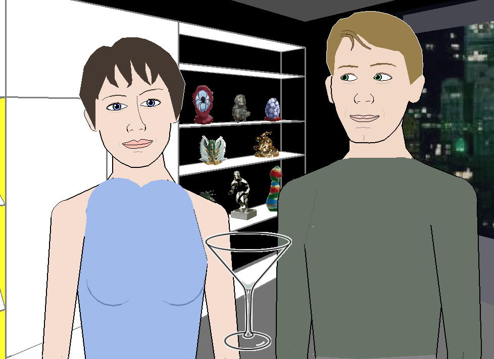

# Façade on Apple Silicon

Play **Façade**, the 2005 interactive drama by Michael Mateas & Andrew Stern, on a modern Apple Silicon Mac with one command.



Façade shipped for Windows XP and 32-bit Mac. The Mac build is dead on Apple
Silicon (no 32-bit support since macOS 26), and the source was never released, so
there is nothing to recompile. This installer does the next best thing: it builds a
self-contained Wine wrapper, installs the Windows version into it, and quietly
replaces the game's dead 2004 Java with a modern one so the AI actually starts. The
result is a single `Facade.app` you double-click like any Mac app, with no Wine,
Java, or anything else to install by hand.

---

## Install

```bash
brew install unar speex  # two small dependencies (see "What it needs")
git clone https://github.com/diego-salomon/facade-apple-silicon.git
cd facade-apple-silicon
./install.sh
```

The game's own installer opens a short setup window. Click **Next** through it and
**Install**, then let it copy the files. When the copy finishes the script takes
over: it decodes the audio natively (under a minute, instead of the installer's
30-to-60-minute decompression), swaps the Java, and drops `Facade.app` into
`~/Applications`.

Then:

```bash
open ~/Applications/Facade.app
```

Type to talk to Grace and Trip. Every session writes a transcript to
`…/Facade/stageplays/` inside the app.

To remove everything it created:

```bash
./uninstall.sh
```

## What it needs

- An **Apple Silicon** Mac (M1 or later), macOS 14.6+.
- **Rosetta 2**. The installer offers to set it up if it's missing (Wine runs
  Façade's 32-bit x86 code, and Rosetta runs Wine's own x86 parts).
- Two small command-line tools, both from Homebrew (`brew install unar speex`):
  - **`unar`**, because macOS's built-in `bsdtar` silently corrupts the game's
    RAR archive, so a real extractor is required.
  - **`speex`**, which provides `speexdec` to decode the game's ~8,400 voice clips
    natively in seconds. The installer's own decoder runs under Rosetta and takes
    30 to 60 minutes, so this is worth it.
- About 3 GB of free disk while installing (the finished app is ~1.1 GB).

## What it changes on your Mac

- Creates `~/Applications/Facade.app` (~1.1 GB).
- Caches the downloads in `~/Library/Caches/facade-apple-silicon` while it works,
  and clears them at the end (keep them with `./install.sh --keep-cache`).
- Installs Rosetta 2 only if it's missing, and only after you say yes.

Nothing else is touched. `uninstall.sh` removes the app and the cache, and leaves
Rosetta, Homebrew, and everything else alone.

---

## How it works

Getting Façade to run is a four-link chain, and the third link is where everyone
gets stuck:

```
Rosetta 2  →  Sikarugir (Wine) wrapper  →  Façade game files  →  bundled Java 1.4.2
 (x86 on ARM)     (Windows on macOS)         (the 2005 build)      ↑ the black screen
```

A Sikarugir wrapper is just an `.app` whose settings live in its `Info.plist`, so
the installer builds one from scratch without the usual GUI tools: it downloads the
official template and Wine engine straight from their GitHub releases, stitches
them together, and creates the Windows environment with the engine's own `wine`
binary.

The interesting bug is the **black screen**. Façade's AI, the drama manager and the
natural-language parser, runs on a **Java 1.4.2 from 2004** that won't start under
modern Wine. The 3D engine launches, waits forever for a Java process that never
comes, and shows nothing. The game hard-codes the Java path and its launch flags
inside a DLL, so the fix is to keep the folder name `j2re1.4.2_06` and swap its
*contents* for **Eclipse Temurin 8 (32-bit)**, which still accepts those 2004 flags.
Java starts, the engine unblocks, and you reach the name screen.

The game's own installer put up a good fight too. It's a 2005 Advanced Installer
self-extractor whose "silent" mode looked impossible until the real culprit turned
out to be a corrupted archive extraction, and it hides a long audio-decompression
step behind the file copy. The full story, with every wrong turn, is in
**[docs/how-it-works.md](docs/how-it-works.md)**. That debugging trail is the most
interesting part of this project.

## Known issue: the menu text

The game **runs and is playable**, mouse and all. The one rough edge is that some
long lines of menu text overlap the line below. The engine draws its text as OpenGL
outlines from a Windows font (`CreateFontA` + `wglUseFontOutlines`), and Wine's
version of that path gets the per-line spacing slightly wrong, so a sentence that
wraps lands on top of the next one. It affects other Wine and CrossOver setups of
Façade too, and installing the real Comic Sans MS (which the installer does) doesn't
fully fix it. The gameplay text where it matters is readable. Contributions welcome.

---

## Credits

- **Façade**: Michael Mateas & Andrew Stern / [Procedural Arts](https://www.interactivestory.net).
- **[Sikarugir](https://sikarugir.com)**: the Wineskin/Kegworks-lineage wrapper this builds on.
- **[Wine](https://www.winehq.org) / [CrossOver](https://www.codeweavers.com)** (CodeWeavers): the Windows compatibility layer.
- **[Eclipse Temurin](https://adoptium.net)**: the modern JRE that replaces Façade's 2004 Java.

## Legal

Façade is **freeware**. Its own readme says *"Façade is freeware - please give
copies to your friends!"* (© 2005-2006 Procedural Arts). Even so, **this repository
ships none of the game's files**: `install.sh` downloads Façade from the Internet
Archive, the Wine engine and template from Sikarugir's releases, and the JRE from
Adoptium, each at install time. The script and documentation here are **MIT**
licensed (see [LICENSE](LICENSE)).

---

*Built with [Claude Code](https://claude.com/claude-code). Façade is a reference
point for an interactive-drama game I'm designing.*
